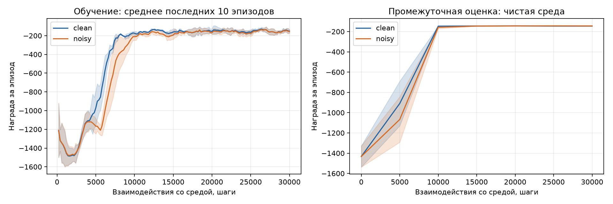
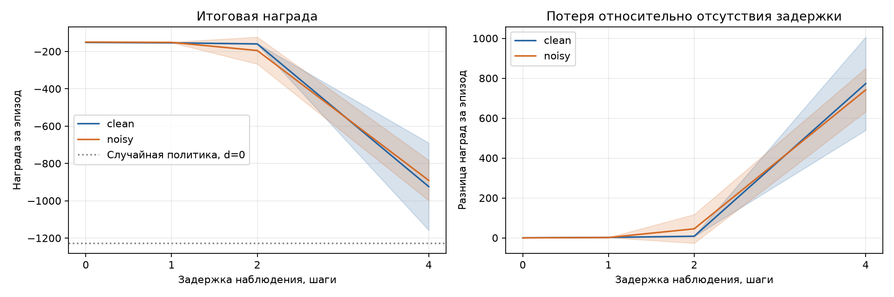

# pendulum_noise_to_delay

Трек 1: управление стандартным Pendulum-v1 с помощью SAC из Stable-Baselines3 на CPU.

[Итоговый ноутбук с выполненными ячейками](notebooks/experiment.ipynb). Основной результат: шум при обучении не дал общего улучшения устойчивости к задержке 2 шага. Эффект E = -37.09 ± 71.01 по 3 seed, знаки отдельных эффектов различаются.

## Исследование

Вопрос: помогает ли шум наблюдений при обучении уменьшить ухудшение управления при задержке наблюдений во время оценки?

Гипотеза: при одинаковом бюджете агент с шумом при обучении потеряет меньше средней награды при задержке на 2 шага, чем агент без шума. Случайная ошибка измерения и устаревшее наблюдение различаются, поэтому перенос устойчивости не гарантирован.

Практический смысл: шум датчика и задержка передачи измерений часто возникают вместе, но требуют разных способов компенсации. Проверяется перенос между двумя типами искажений, а не сравнение алгоритмов или подбор learning rate. Шум может уменьшить чувствительность политики к малым ошибкам, однако задержка зависит от динамики состояния и делает наблюдение устаревшим. Поэтому знак эффекта заранее не очевиден.

Сравниваются две конфигурации:

- `clean`: обычные наблюдения при обучении
- `noisy`: гауссов шум угла со стандартным отклонением 0.05 рад и скорости со стандартным отклонением 0.1 рад/с

После изменения угла пересчитываются косинус и синус, измеренная скорость ограничивается границами наблюдения. Шум не меняет истинное состояние и награду. Динамика, действия, награда и длительность эпизода остаются стандартными. Архитектура, гиперпараметры и бюджет одинаковы. На задержанных наблюдениях агенты не обучаются.

## Среда и алгоритм

Цель Pendulum-v1: поднять маятник и удерживать его около верхней вертикали. Наблюдение `[cos(theta), sin(theta), omega]` содержит угол и угловую скорость. Действие задаёт момент силы от -2 до 2 Н·м. Награда за шаг равна `-(theta² + 0.1 omega² + 0.001 torque²)`, где угол нормализован от -π до π, а ноль соответствует верхней вертикали. Штрафы поощряют точное удержание с небольшой скоростью и усилием.

Эпизод ограничен 200 шагами по 0.05 с и завершается по `truncated`, достижение вертикали не завершает его. SAC выбран как готовый алгоритм для непрерывных действий. Пилот подтвердил работоспособность на CPU в доступном бюджете. Случайная политика служит простым ориентиром качества.

## Условия и оценка

Параметры и seed находятся в `src/config.py`.

| Назначение | Seed |
| --- | --- |
| Пилотное обучение | 0, 1, 2 |
| Пилотная оценка | 100-104 |
| Основное обучение | 42, 43, 44 |
| Промежуточная оценка | 200-204 |
| Итоговая оценка | 1000-1019 |
| Анимации | модель с seed 42, эпизод с seed 2000 |
| Действия случайной политики | 3000 |

Выполнены 6 основных запусков: 2 конфигурации по 3 seed. После пилота зафиксирован общий бюджет 30 000 шагов, сеть с двумя слоями по 64 нейрона и один поток PyTorch на CPU. Ограничение одного запуска: 30 минут. Пилотные запуски этого бюджета на текущей машине заняли менее 57 с. Итоговая модель берётся после фиксированного числа шагов, без выбора по тестовым результатам.

Промежуточная оценка: 5 эпизодов без шума и задержки. Итоговая оценка: по 20 одинаковых начальных seed для каждой модели при задержках 0, 1, 2, 4 шага, без обучения и шума, с детерминированными действиями. Всего 480 эпизодов обученных агентов. Случайная политика дополнительно оценивается на 20 тестовых эпизодах в обычной среде.

Задерживается только наблюдение. Недостающая история в начале эпизода заполняется начальным наблюдением. Проверенный шаг среды 0.05 с, задержки соответствуют 0, 0.05, 0.10, 0.20 с модельного времени.

## Метрики

`R_c,s(d)` - средняя сумма стандартных наград за 20 эпизодов для конфигурации c, seed обучения s и задержки d. Большее значение лучше.

`D_c,s(d) = R_c,s(0) - R_c,s(d)` - потеря качества относительно отсутствия задержки.

`E_s = D_clean,s(2) - D_noisy,s(2)` - основное сравнение. Положительное значение соответствует гипотезе. Одновременно сравниваются абсолютные награды при задержках 0 и 2: малая потеря у изначально слабого агента не доказывает практическую устойчивость.

Сначала усредняются эпизоды каждого запуска, затем показываются среднее и выборочное стандартное отклонение по 3 seed, а также отдельные значения E. Эпизоды не считаются независимыми повторениями обучения. Процентное падение отрицательных наград не используется. Неоднозначный и отрицательный результаты сохраняются.

До итогового теста зафиксировано правило вывода: положительное среднее E соответствует направлению гипотезы, но рассматривается вместе со знаками E отдельных seed и разбросом. Разные знаки означают неоднозначность. Практическая устойчивость оценивается также по абсолютным наградам при задержках 0 и 2, чтобы исключить объяснение низким исходным качеством. При 3 seed статистическая значимость не заявляется, произвольный порог не вводится.

## Установка

Проверены существующая `.venv` и установка с нуля в отдельное окружение на Python 3.13.1, macOS 26.2, Apple Silicon arm64. Linux/Colab не проверен. Версии зависимостей закреплены в `requirements.txt`.

Из корня проекта с Python 3.13:

```bash
python3 -m venv .venv
source .venv/bin/activate
python -m pip install -r requirements.txt
python -m pip check
```

В PyCharm интерпретатор проекта должен указывать на `.venv/bin/python`. Для ноутбуков используется `IDE-Managed Server (Auto)`. После смены интерпретатора перезапустите kernel.

## Среды

В `src/envs.py` реализованы `ObservationNoise`, `ObservationDelay` и функция `make_env`. Из корня проекта:

```python
from src.envs import make_env

env = make_env("noisy")
observation, info = env.reset(seed=42)
env.close()

env = make_env(delay=2)
observation, info = env.reset(seed=100)
env.close()
```

`make_env()` создаёт чистую среду. `make_env("noisy")` предназначена для обучения с шумом, `make_env(delay=2)` для оценки любой модели без шума с задержкой. Совместное включение шума и задержки запрещено условиями эксперимента.

Генератор шума инициализируется через `SeedSequence([seed, 1])` при `reset(seed=...)`, независимо от генератора среды. При `reset()` без seed поток шума продолжается. Задержка очищает историю при каждом сбросе, хранит и возвращает копии наблюдений.

Проверки обёрток выполнены без обучения: проверка API Stable-Baselines3, 2400 парных шагов для состояния, награды, границ, dtype и завершения эпизода, точное совпадение при нулевом шуме и нулевой задержке. Проверены воспроизводимость, 64 сдвига счётной последовательности для задержек 0, 1, 2, 4, очистка истории и защита буфера от изменения возвращённого массива. На 20 000 измерений стандартные отклонения шума составили 0.049833 рад и 0.100430 рад/с. Проверки выполнены на macOS arm64.

## Обучение и оценка

Команды выполняются из корня проекта после активации `.venv`. Короткая техническая проверка на пилотном seed:

```bash
python -m src.train --condition clean --seed 0 --steps 220 --eval-frequency 110 --output artifacts/check_clean
python -m src.train --condition noisy --seed 0 --steps 220 --eval-frequency 110 --output artifacts/check_noisy
python -m src.evaluate --runs artifacts/check_clean artifacts/check_noisy --split pilot --output artifacts/check_evaluation
```

Для повторного запуска укажите новые выходные папки: существующие результаты не перезаписываются. Эти 220 шагов нужны только для проверки обновления весов, сохранения и загрузки, а не для проверки гипотезы.

`src/train.py` сохраняет последнюю модель в `model.zip`, награды завершённых обучающих эпизодов в `train.monitor.csv`, результаты промежуточной оценки по эпизодам в `evaluation.csv`, параметры и время в `metadata.json`. Оценка проходит до обучения, каждые `--eval-frequency` шагов и в конце, без шума и задержки. Время включает создание модели и промежуточную оценку, но не запись итогового checkpoint.

Для основных запусков предназначен `--split main`, разрешены seed 42, 43, 44, оценка использует seed 200-204. Для пилота используется `--split pilot`, seed обучения 0, 1, 2 и оценки 100-104. По умолчанию выполняются 30 000 шагов с оценкой каждые 5000. В пилоте их можно изменить через `--steps` и `--eval-frequency`, для основных запусков отклонение от зафиксированных значений запрещено. Ограничение 1800 с не останавливает обучение автоматически, чтобы бюджеты конфигураций не расходились.

`src/evaluate.py` загружает модели на CPU и оценивает каждую при всех 4 задержках. `--split pilot` используется по умолчанию. `--split test` включает итоговые 20 seed и предназначен только для завершённого основного эксперимента.

Выходные таблицы оценки:

- `episodes.csv`: награда, длина и признаки завершения каждого эпизода модели
- `runs.csv`: средняя награда и потеря качества по запуску и задержке
- `summary.csv`: среднее и выборочное стандартное отклонение между seed
- `effects.csv`: парное сравнение потерь при задержке 2 для каждого seed
- `random.csv`: эпизоды случайной политики в чистой среде
- `evaluation.json`: выбранные модели, seed и условия оценки
- `training.csv`, `intermediate.csv`: объединённые журналы обучения и промежуточной оценки

При одном seed стандартное отклонение между запусками не определено и сохраняется пустым. Для итогового анализа передаются все 6 моделей с одинаковыми настройками и бюджетом.

Проверка обучения и оценки: обе конфигурации прошли по 220 шагов и 120 обновлений SAC. Веса изменились, загруженные модели воспроизвели оценку, оценка не изменила веса. Промежуточные оценки записаны на шагах 0, 110, 220. Итоговый путь оценки проверен на 40 пилотных эпизодах моделей и 5 эпизодах случайной политики, каждый по 200 шагов. Тестовые seed 1000-1019 не использовались. Расчёт потерь и стандартного отклонения отдельно проверен на данных с известным ответом.

## Пилот и зафиксированные настройки

Оборудование: Apple M1 Max, 10 логических ядер, 64 ГиБ памяти. Выполнение на CPU с одним потоком PyTorch, macOS 26.2, Python 3.13.1. Оценка на 5 эпизодах с seed 100-104, без шума и задержки. Данные кривых и отдельных эпизодов сохранены в [results/pilot.csv](results/pilot.csv), модели находятся в исключённой из Git папке `artifacts/`.

| Конфигурация | Seed обучения | Шаги | Средняя награда последней модели | Время, с |
| --- | --- | --- | --- | --- |
| clean | 0 | 10 000 | -221.739 | 20.480 |
| clean | 1 | 30 000 | -143.816 | 55.975 |
| noisy | 1 | 30 000 | -143.170 | 56.959 |
| clean | 2 | 30 000 | -143.844 | 56.163 |
| noisy | 2 | 30 000 | -143.574 | 56.425 |
| Случайная политика | нет | 0 | -1418.917 | нет |

Случайная политика оценена на тех же 5 начальных состояниях. При 30 000 шагах улучшение относительно случайной политики составляет не менее 1275.07 единицы награды за эпизод. Это подтверждает работоспособность обучения на пилотной выборке, но не гипотезу переноса.

Выбран бюджет 30 000 шагов: у `noisy` с seed 1 награда на 20 000 шагах ещё была -194.08, к 25 000 достигла -143.30. Последние модели обеих конфигураций при seed 1 и 2 дают близкое качество. Перебор архитектур и уровней шума не проводился. Сравнение 10 000 шагов на seed 0 с 30 000 на других seed не используется как доказательство эффекта бюджета.

Общие настройки SAC: `MlpPolicy`, сеть `(64, 64)`, learning rate 0.0003, buffer size 100000, learning starts 100, batch size 256, tau 0.005, gamma 0.99, одно обновление после каждого шага, автоматический коэффициент энтропии. Остальные настройки соответствуют Stable-Baselines3 2.9.2. Промежуточная оценка каждые 5000 шагов. Шум остаётся 0.05 рад и 0.1 рад/с. Все значения seed сохраняются без изменений.

В пилоте обнаружена и исправлена ошибка журнала: оценка на последнем шаге могла предшествовать последнему обновлению весов. Теперь она пересчитывается после завершения обучения. Последние строки старых пилотных журналов заменены оценками сохранённых моделей, максимальная поправка отдельного эпизода составила 0.444. Обучение не затронуто. Короткая проверка после исправления подтвердила совпадение последней оценки с загруженной моделью без дублирования строк.

Повтор пилота с новым выходным каталогом:

```bash
python -m src.train --condition clean --seed 2 --split pilot --output artifacts/pilot_repeat_clean_2
python -m src.train --condition noisy --seed 2 --split pilot --output artifacts/pilot_repeat_noisy_2
```

Пример основного запуска:

```bash
python -m src.train --condition clean --seed 42 --split main --output artifacts/main_clean_42
```

Итоговые тестовые seed и задержки для проверки гипотезы в пилоте не использовались. Linux/Colab не проверен.

## Основной эксперимент

Выполнены все 6 запусков с зафиксированными настройками. Каждый получил 30 000 шагов, всего 180 000. Модели оценены без обучения на seed 1000-1019 при задержках 0, 1, 2, 4. Получены 480 эпизодов моделей и 20 эпизодов случайной политики. Каждый эпизод длился 200 шагов. Никакие seed не исключались.

| Конфигурация | Seed | Время обучения и промежуточной оценки, с |
| --- | --- | --- |
| clean | 42 | 56.705 |
| clean | 43 | 57.319 |
| clean | 44 | 57.326 |
| noisy | 42 | 56.763 |
| noisy | 43 | 56.961 |
| noisy | 44 | 56.740 |

Суммарное время запусков 341.813 с, без итогового теста и записи checkpoint. Максимум одного запуска 57.326 с, меньше лимита 1800 с. Оборудование и число потоков те же, что в пилоте.

Средняя награда и выборочное стандартное отклонение между 3 seed, после усреднения 20 эпизодов каждого запуска:

| Задержка, шаги | clean | noisy |
| --- | --- | --- |
| 0 | -151.43 ± 1.07 | -149.73 ± 1.11 |
| 1 | -153.72 ± 0.56 | -151.33 ± 1.33 |
| 2 | -159.53 ± 1.53 | -194.93 ± 72.26 |
| 4 | -924.13 ± 233.93 | -890.90 ± 108.17 |

Случайная политика в чистой среде: -1227.27. Обе обученные конфигурации без задержки заметно превосходят этот ориентир.

| Seed | Потеря clean при d=2 | Потеря noisy при d=2 | E |
| --- | --- | --- | --- |
| 42 | 9.09 | 128.17 | -119.08 |
| 43 | 8.65 | 4.40 | 4.25 |
| 44 | 6.56 | 3.01 | 3.55 |

Среднее E равно -37.09, стандартное отклонение 71.01. Знаки различаются: на seed 43 и 44 шум немного уменьшает потерю, на seed 42 значительно увеличивает. Гипотеза об общем улучшении устойчивости не получила подтверждения. В среднем `noisy` также уступает по абсолютной награде при d=2, несмотря на немного лучшее качество без задержки. Разбор отдельных эпизодов и поведения приведён в итоговом ноутбуке. Причинный механизм по этим данным не установлен.

Материалы находятся в [results/main](results/main): `episodes.csv`, `random.csv` и агрегированные таблицы, `training.csv` с 900 обучающими эпизодами, `intermediate.csv` с 210 промежуточными оценками. В `evaluation.json` сохранены настройки и времена всех запусков, контрольные суммы моделей, версия кода и полный снимок `pip freeze`. Модели находятся в `artifacts/main_*` и исключены из Git.

Полный повтор из свежего клона репозитория, где ещё нет каталогов `artifacts/main_*`:

```bash
for condition in clean noisy
do
    for seed in 42 43 44
    do
        python -m src.train --condition "$condition" --seed "$seed" --split main --output "artifacts/main_${condition}_${seed}"
    done
done
```

Оценка полученных моделей и сбор таблиц кривых обучения:

```bash
python -m src.evaluate --runs artifacts/main_clean_42 artifacts/main_clean_43 artifacts/main_clean_44 artifacts/main_noisy_42 artifacts/main_noisy_43 artifacts/main_noisy_44 --split test --output artifacts/repeated_test
python -m src.plots --data artifacts/repeated_test --output artifacts/repeated_figures
```

При повторе в рабочем проекте задайте новые пути обучения и передайте те же пути в `--runs`. Исходные таблицы в `results/` сохраняются для сравнения. `training.csv` и `intermediate.csv` собираются из журналов запусков автоматически. Пересоздание анимаций использует модели с seed 42 в стандартных каталогах `artifacts/main_*`.

Таблицы для графиков уже сохранены, повторное обучение для их анализа не требуется. Проверены полнота всех 24 сочетаний модели и задержки, уникальность эпизодов, тестовые seed, одинаковые бюджеты и настройки, завершение эпизодов и независимый пересчёт E из исходных наград.

## Графики, анимации и выводы

[Итоговый ноутбук](notebooks/experiment.ipynb) содержит выполненные ячейки, таблицы, графики и 4 встроенные анимации. Он читает сохранённые результаты без обучения и загрузки моделей.





- [Основное сравнение по seed](results/figures/effects.png)
- [Угол и управляющий момент](results/animations/behavior.png)

Полосы на графиках показывают выборочное стандартное отклонение между 3 seed. Обучающая награда сглажена окном 10 эпизодов отдельно для каждого запуска. Промежуточные оценки усреднены по 5 эпизодам без сглаживания.

У `noisy`, seed 42, при задержке 2 награды эпизодов 1002, 1004 и 1015 составили -1037.69, -1003.38 и -1005.02. Эти 3 эпизода дают вклад -121.03 в разницу средних наград noisy и clean по 20 эпизодам этого seed. Полная разница равна -117.07. Провалы сохранены в расчётах, а небольшое преимущество остальных seed не подтверждает общую устойчивость.

| Условие | Без задержки | Задержка 2 шага |
| --- | --- | --- |
| clean |  |  |
| noisy |  |  |

Дополнительный разбор после итоговой оценки: для модели с seed 42 при d=2 в эпизодах 1002, 1004, 1015 среднеквадратичный нормализованный угол на последних 100 шагах составил у clean 0.175, 0.177, 0.177 рад, у noisy 1.513, 1.518, 1.490 рад. Доля этих шагов с |theta| < 0.2 рад равна 59%, 59%, 58% и 12%, 11%, 12% соответственно. Угол измерен перед действием. Это указывает на плохое удержание около вертикали, а не только на различия затрат управления. Порог 0.2 рад выбран для описания поведения после теста и не является заранее заданной метрикой успеха или основанием проверки гипотезы.

Анимации используют заранее выбранные seed модели 42 и эпизода 2000. В этом эпизоде обе конфигурации удерживают маятник и при задержке 2, поэтому анимации не представляют все тестовые ошибки. При переходе от задержки 0 к 2 среднеквадратичный момент на последних 5 с вырос у clean с 0.65 до 1.61 Н·м, у noisy с 0.33 до 1.28 Н·м. Это наблюдение одного эпизода, а не доказательство причины провалов.

Для пересоздания графиков по сохранённым CSV и открытия ноутбука:

```bash
python -m src.plots
python -m jupyterlab notebooks/experiment.ipynb
```

Для пересоздания анимаций нужны сохранённые модели `artifacts/main_clean_42/model.zip` и `artifacts/main_noisy_42/model.zip`:

```bash
python -m src.render
```

Проверены выполнение всех ячеек ноутбука, установка зависимостей в чистое окружение, API сред, короткое обучение на 220 шагах, сохранение и загрузка модели с совпадением оценки. Три графика по CSV воспроизведены побайтно. Все 4 GIF содержат по 10 с модельного времени.

Ограничения: одна среда, один алгоритм, 3 seed, фиксированные уровни шума и 20 тестовых эпизодов на условие. Разброс велик, статистическая значимость и механизм переноса не установлены. Следующая проверка потребовала бы дополнительных seed и анализа траекторий провальных эпизодов с заранее заданным протоколом.

## Структура

- `src/config.py` - параметры эксперимента
- `src/envs.py` - классы обёрток шума и задержки, создание среды
- `src/train.py` - обучение SAC и промежуточная оценка
- `src/evaluate.py` - итоговая оценка и метрики
- `src/plots.py` - графики по сохранённым таблицам
- `src/render.py` - анимации и траектории выбранного эпизода
- `notebooks/experiment.ipynb` - итоговый анализ
- `results/` - таблицы, метаданные оценки, графики и анимации
- `artifacts/` - модели и рабочие логи, исключённые из Git

Для сдачи требуется ссылка на общедоступный GitHub-репозиторий. README служит отчётом, ноутбук содержит подробный анализ и встроенные результаты.
